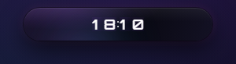
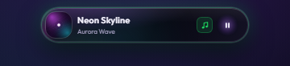
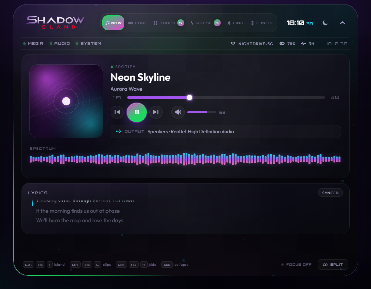
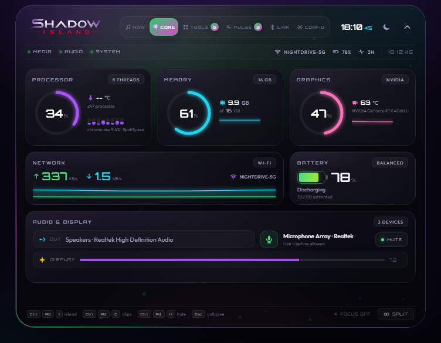
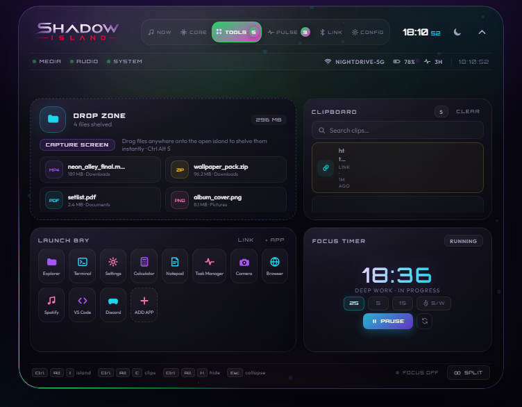
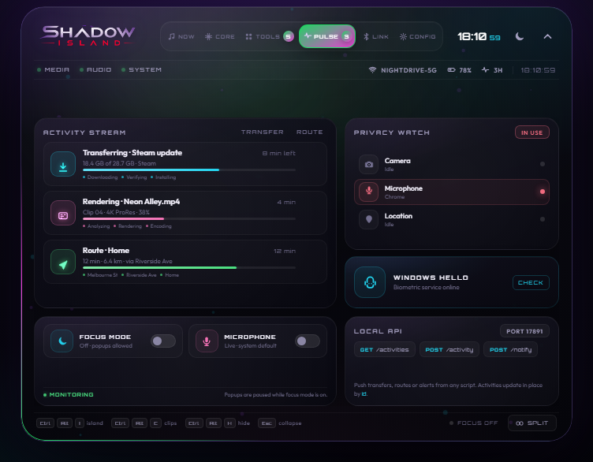
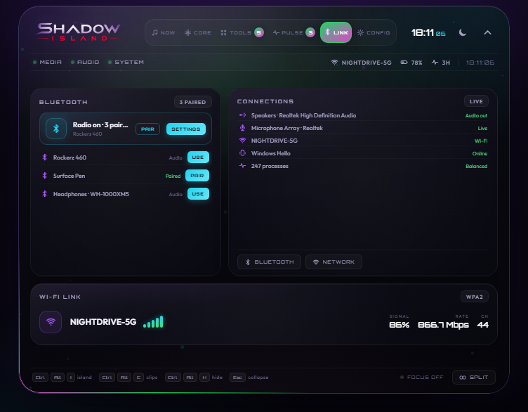
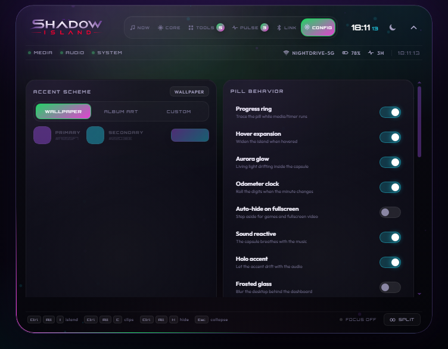

# Shadow Island

An iPhone-style **Dynamic Island for Windows** — a frameless, always-on-top overlay that sits at the
top of the screen and turns your PC into something that feels like an iPhone: live media, lyrics,
system vitals, tools and live activities, all inside a small neon capsule that expands on hover and
unfolds into a full control center when you click it.

<p align="center">
  
  
</p>

<p align="center">
  
</p>

| | | |
| :--: | :--: | :--: |
|  |  |  |
|  |  | |

---

## Highlights

- **Three-size island** — a small resting capsule (240–256 px), a medium pill that widens on hover
  (292–324 px) with prev/next controls, and the large 720 × 552 control center that opens on click.
- **The dashboard unfolds out of the pill** — the panel starts as a thin capsule at the top centre and
  stretches into the full dashboard with a soft spring; closing folds it back into the island.
- **Odometer clock** — the idle face is a rolling digit clock (every digit rides a vertical strip),
  so the time rolls over instead of popping.
- **Real media integration** — Windows SMTC sessions (title, artist, artwork, timeline), synced
  lyrics from LRCLIB, transport controls and artwork-driven accent colour.
- **Real system telemetry** — CPU / RAM / GPU / network / battery / uptime, privacy indicators
  (webcam, mic, location), brightness, audio output and microphone state.
- **Live activities** — transfers, renders, navigation, timers; the pill morphs into whichever
  activity is running and shows a progress ring.
- **Productivity tools** — clipboard history with search, an app/URL launcher, a focus timer and
  stopwatch, plus a drop zone that accepts files dragged onto the island.
- **Theming that follows Windows** — light/dark mode and accent colour are picked up from the
  system, the wallpaper or the current album artwork; everything can be overridden in CONFIG.
- **Tray menu, global shortcuts and a local HTTP API** for notifications and activity pushes.

---

## Install (end users)

1. Run `Shadow Island Setup 1.2.1.exe` (NSIS installer, per-user, no admin rights required).
   A portable `Shadow Island 1.2.1.exe` is produced as well.
2. Launch **Shadow Island** — it appears in the top-centre of the screen and in the system tray.
3. Optional: open **CONFIG → Start with Windows** to launch it automatically at login.

The installer ships the three helper binaries (`media-bridge.exe`, `volume-bridge.exe`,
`system-bridge.exe`) inside `resources/bridge`, so no Python installation is required.

---

## Develop from source

```bash
npm install          # electron + electron-builder
npm start            # run the app (dev)
npm run dev          # run with DevTools open
```

The app shells out to three Python helpers that live in `bridge/`. For development they are started
with the `python` on your PATH; for a release they are frozen with PyInstaller:

```bash
pip install pyinstaller winsdk winrt-WinRT.Runtime pycaw comtypes psutil pillow
npm run bridge:build      # writes bridge/dist/*.exe
npm run dist              # electron-builder → release/ (NSIS + portable)
npm run dist:dir          # unpacked build for quick smoke tests
```

### Renderer preview mode

The renderer ships with a mock backend so the UI can be captured without touching the real system:

```bash
npx electron tools-shot.js now      preview-now.png     # pages: now/system/tools/live/link/settings
npx electron tools-shot.js compact  preview-compact.png # compact pill
npx electron tools-shot.js idle     preview-idle.png    # idle clock face
```

---

## Layout

```
src/main.js           Electron main process: window, tray, shortcuts, IPC, HTTP API
src/preload.js        contextBridge surface exposed as window.islandAPI
src/system-bridge.js  supervises the three Python helpers and merges their state
bridge/*.py           media (WinRT SMTC), volume (Core Audio), system (telemetry)
renderer/index.html   island markup + SVG icon sprite
renderer/styles.css   the complete visual system (dark glass, neon, light theme)
renderer/js/*.js      core, media, system, tools, live, pill, dock, settings, visuals, extras, mock, boot
assets/               app icon (.ico/.png) and tray icon
docs/screenshots/     the screenshots used in this README
```

---

- The island **never appears on the taskbar** — it is a tray-only app. The window is forced to
  skip the taskbar on creation and every time it is shown, so it can never claim a slot next to
  your other apps.
- The tray icon is always present: **Hide island / Show island**, **Open control center**,
  **Open clipboard**, **Reset island position**, focus mode, always-on-top, launch at login and
  quit all live in the tray menu.

## Global shortcuts

| Shortcut | Action |
| --- | --- |
| `Ctrl+Alt+I` | open / close the control center |
| `Ctrl+Alt+C` | open the clipboard history |
| `Ctrl+Alt+N` | send a test notification |
| `Ctrl+Alt+M` | play / pause the active media session |
| `Ctrl+Alt+F` | toggle focus mode (silences notifications) |
| `Ctrl+Alt+H` | hide / show the island |

**Inside the control center**

| Key | Action |
| --- | --- |
| `Esc` | close the panel |
| `←` / `→` | switch page (NOW / CORE / TOOLS / PULSE / LINK / CONFIG) |
| `↑` / `↓` | system volume ±5 % |
| `Space` | play / pause |
| scroll on the capsule | system volume ±5 % (the volume HUD confirms) |

**Moving the island**

Hold `Ctrl + Shift` and drag the capsule: it follows the cursor, snaps to the top, bottom,
left or right screen edge (and to the centre/corners along that edge) and turns into a vertical
capsule on the side edges. The position is remembered between sessions; the tray menu has
*Reset island position*.

---

## HTTP API

A tiny local server runs on `http://127.0.0.1:17891`:

| Method | Path | Purpose |
| --- | --- | --- |
| `GET` | `/health` | app status, bridge state, activity count |
| `GET` | `/activities` | list live activities |
| `POST` | `/activity` | push an activity (`{"title","body","progress","icon","tone"}`) |
| `DELETE` | `/activity/<id>` | dismiss an activity |
| `POST` | `/notify` | show a notification toast in the island |

```bash
curl -X POST http://127.0.0.1:17891/notify \
  -H "Content-Type: application/json" \
  -d '{"title":"Build finished","body":"Shadow Island is ready","tone":"success"}'
```

---

## How the click-through overlay works

The island is a transparent, always-on-top window that must not steal clicks from the desktop.

- The window is **resized to the artwork it actually shows** (small pill ≈ 288 px, medium pill
  ≈ 340 px, control center 820 × 660) instead of staying a large transparent rectangle. It also
  keeps enough room around the capsule for the outer glow and drop shadow to fade out.
- Window resizes are **animated** (420 ms, eased, even widths and a fixed centre) so the island
  never jumps — not even by a fraction of a pixel, which would make the clock digits shimmer.
- The renderer hit-tests every mouse move and asks the main process to toggle
  `setIgnoreMouseEvents`, so only the visible island reacts to the mouse.
- Because the window matches the artwork, clicking next to the island reaches the desktop again
  instead of being swallowed by an invisible overlay.

---

## Known limitations

- Media position comes from the Windows SMTC timeline. Some players (Chrome/Edge in particular)
  freeze that timeline; the island compensates by extrapolating and never letting the progress bar
  jump backwards, but the elapsed time can drift from the audio by a second or two.
- Ride, flight, sports and turn-by-turn activities are rendered from the local activity API — there
  is no native Windows integration for them.
- Windows Hello and system-wide notification capture are not implemented; notifications are
  delivered through the local API, the tray and the in-island toast.
- Drag & drop only works while the island is interactive (an OS drag does not reach a click-through
  window).
- `Ctrl+Alt+D` was reserved by another application on the development machine, so hide/show is
  bound to `Ctrl+Alt+H`.

---

## Credits

Artwork (emblem, wordmark, idle art) is original work created for Shadow Island.
Lyrics are fetched from [LRCLIB](https://lrclib.net).
